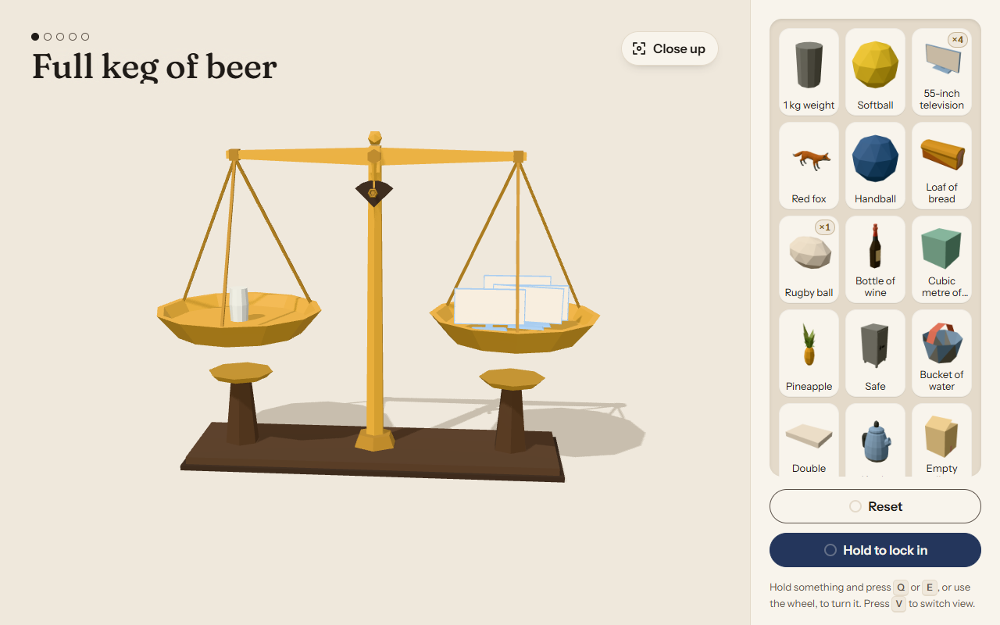

# Perfect Balance



A daily 3D balance-scale game. You get a thing on one pan, say an elephant, and a shelf of everyday objects to stack on the other until you think the weights match. Then the scale lets go. Land between 3% light and 4% heavy and the round's yours. There are five rounds a day, the same for everyone, and a Freeplay mode where you set the difficulty, the number of things you can use, endless rounds or a theme.

**Play it:** https://perfect-balance.kieronoates.workers.dev

## Why I built this

I built Perfect Balance to make a game out of judging weight by eye, and to see how real I could make the physics feel in a phone browser. Each part was a problem I wanted to solve properly:

- **Physics that feels real, on a phone.** Jolt, compiled to WebAssembly, runs in a Web Worker, so piles of things slide, topple and settle without the page stuttering. When a pan is locked in, it's made heavy enough that nothing on it can sink through.
- **A sugar cube and an elephant in the same game.** Each round's world is scaled to the objects in it, so both behave sensibly on the same scale.
- **Rounds that can always be won.** Each round is generated from a seed with its answer built first, and the daily puzzle is the same seed for everyone, so results can be compared and shared.
- **Weights you can check.** Every one of the 200 objects has its weight from two independent sources, quoted in `src/data/catalogue.json`. The game only downloads the fields it plays with.
- **Fast to start.** The first page needs about 36 KB of script; three.js, the physics and the game load after it. The models are low-poly, recoloured to one palette and compressed with meshopt, so a round's models come to about 30 KB.

## Running it locally

You need Node 24.

```sh
npm install
npm run dev        # the site on localhost:5173
npm run check      # type-check everything
npm run build      # build into dist/
npx wrangler dev   # the built site as Cloudflare serves it, after a build
```

The models in `src/assets/models` are already built. `npm run models` rebuilds them from the original downloads, which aren't in the repo.

## Tech

Svelte 5, TypeScript, Vite, three.js, Jolt Physics (WebAssembly), Web Workers, camera-controls, glTF Transform and meshoptimizer for the model pipeline, and a Cloudflare Worker serving static assets.

## Credits and licences

- My code is MIT licensed (see `LICENSE`).
- 3D models by [Kenney](https://kenney.nl) (CC0), Quaternius, CreativeTrio and Isa Lousberg (CC0, via [Poly Pizza](https://poly.pizza)), and Poly by Google (CC BY 3.0, recoloured and simplified). Every model's source and licence is in `src/data/credits.json`.
- Weights come from standards bodies, sports governing bodies, manufacturers, government databases and published studies. Each entry in `src/data/catalogue.json` quotes its source.
- [Fraunces](https://github.com/undercasetype/Fraunces) and [Instrument Sans](https://github.com/Instrument/instrument-sans), SIL Open Font License 1.1, via Fontsource.
- [three.js](https://threejs.org), [JoltPhysics.js](https://github.com/jrouwe/JoltPhysics.js), [camera-controls](https://github.com/yomotsu/camera-controls), [Svelte](https://svelte.dev) and [Vite](https://vite.dev), MIT. [TypeScript](https://www.typescriptlang.org), Apache 2.0.
